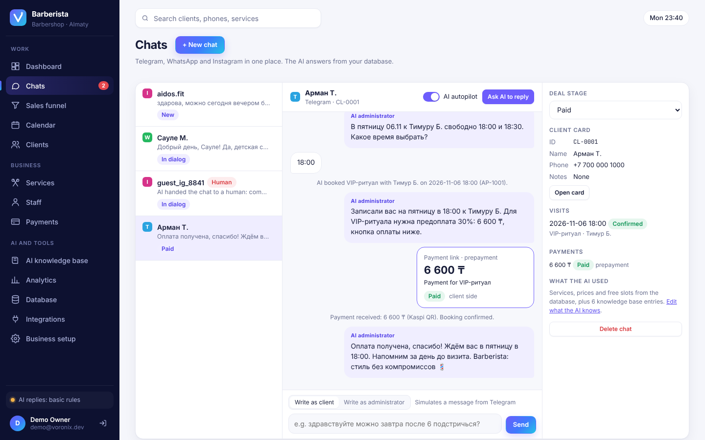
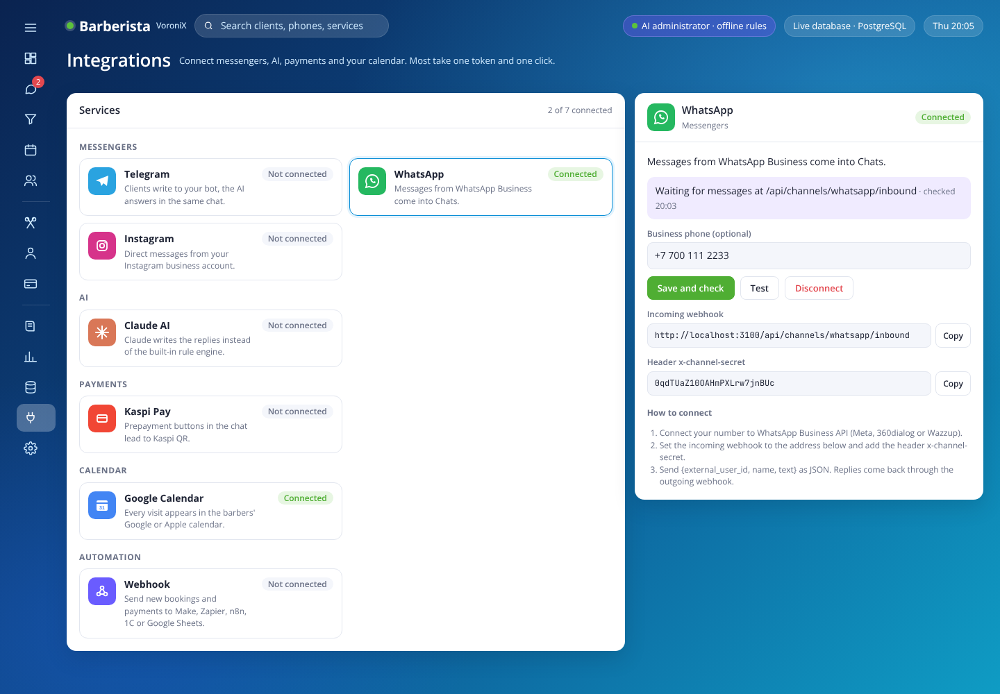
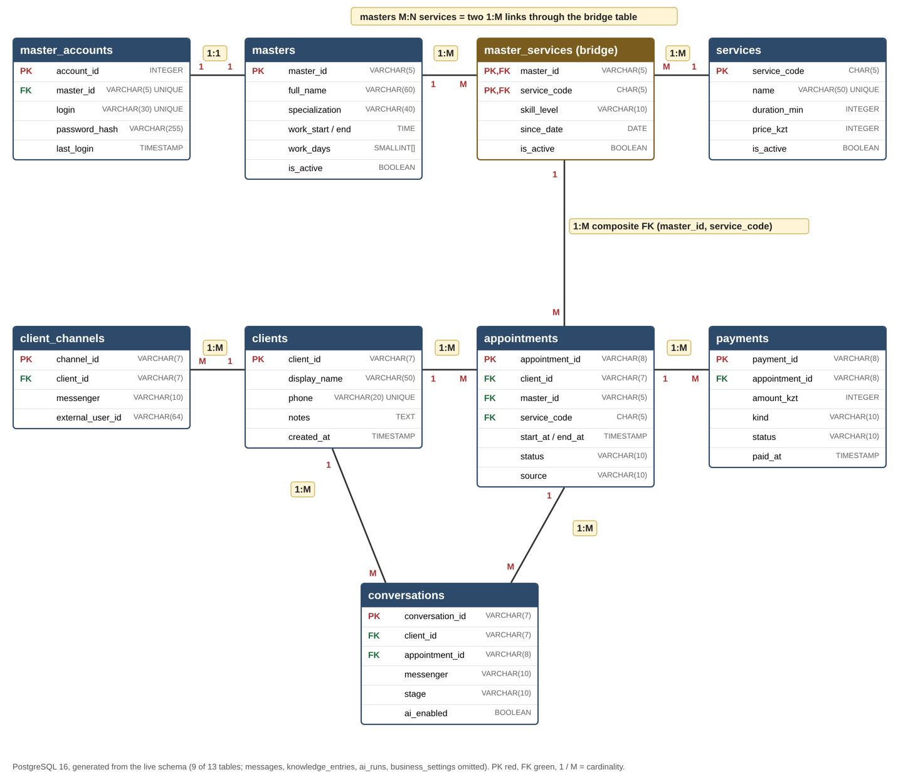
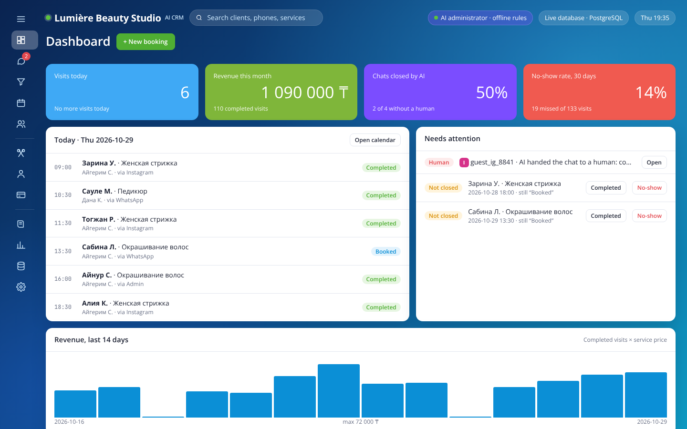
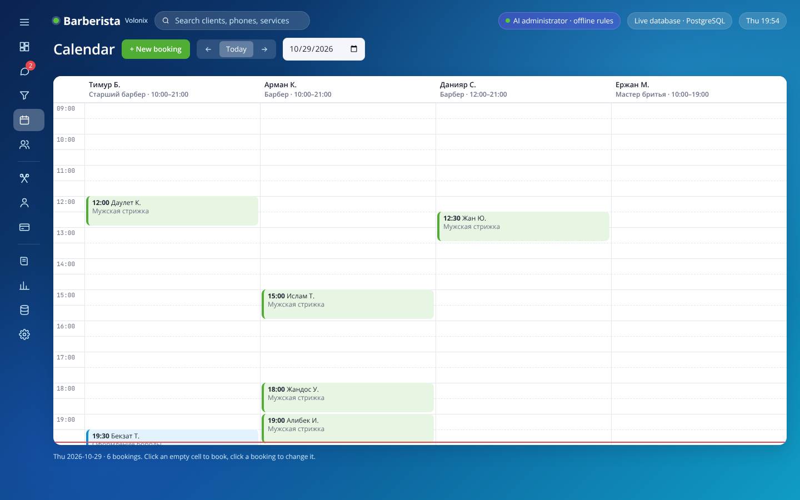
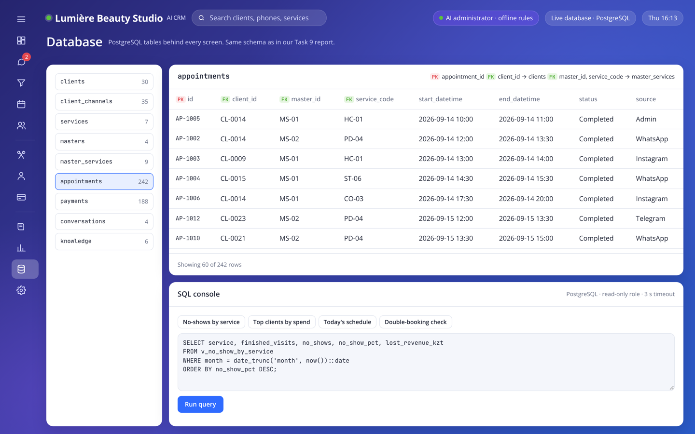
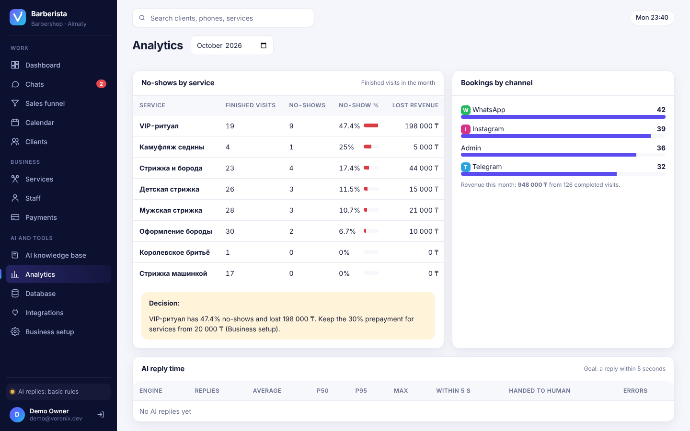

# VoroniX

**AI CRM for small business.** An AI administrator and CRM for appointment-based businesses (beauty salons, barbershops, clinics).
Clients write in **Telegram, WhatsApp or Instagram**. The AI answers **only from the CRM database**: real services, real prices, real free time. It books the visit, sends a prepayment link and moves the deal through the sales funnel. Complaints go to a human.



| Requirement | How it is met | Proof |
|---|---|---|
| FR-01 messages from three messengers | `POST /api/channels/:messenger/inbound`, Telegram bot adapter | `ai-flow.test.ts` |
| FR-02 answers from the database | 7 CRM tools; the AI never runs SQL itself | `ai-flow.test.ts` |
| FR-03 booking and payment | EXCLUDE constraint, payment transaction | `database.test.ts`, `api.test.ts` |
| NFR-01 reply within 5 s | every AI run logged in `ai_runs` with latency | p95 380 ms under load |
| Business-specific AI | “Teach the AI”: paste promotions, rules, a slogan; the AI sorts them into knowledge entries and settings in the database and uses them in replies | `teach.test.ts`, `ai-flow.test.ts` |
| BR-01 no invented prices | prices come from `services`, unknown services are refused | `ai-flow.test.ts` |

## Try it

| | Link | What works |
|---|---|---|
| Demo in the browser | [GitHub Pages](https://GITHUB_USER.github.io/voronix/) | The whole CRM with the demo barbershop Barberista; changes stay in your tab, the AI is off |
| Demo with the AI | [claude.ai](https://claude.ai/artifact/ADSNg68LNiherEJNbSeMdR) | Same CRM with a live AI administrator and a shared database |
| Full system | [Deploy to Render](https://render.com/deploy?repo=https://github.com/GITHUB_USER/voronix) | API, web CRM and PostgreSQL from `render.yaml`, free plan |

On the first open of a deployed copy, press **Load demo data** in the banner to fill it with Barberista: 8 services, 4 barbers, 30 clients, 8 weeks of visits and 4 chats.

## Integrations



The **Integrations** page connects the CRM to outside services. Tokens are checked against the real service, stored in the `integrations` table, never sent back in full and hidden from the read-only SQL console.

| Service | What it does | How |
|---|---|---|
| Telegram | The AI answers clients in your bot | Paste the @BotFather token; the bot starts at once |
| Claude AI | Claude writes the replies instead of the rule engine | Paste an Anthropic API key; checked and switched on at once |
| WhatsApp, Instagram | Messages land in Chats | Ready webhook address with its own `x-channel-secret` for Meta, 360dialog, Wazzup, Make or n8n |
| Google Calendar | Every visit in the barbers' calendars | Private iCal address, add it in Google or Apple Calendar |
| Webhook | New bookings and payments go to Make, Zapier, n8n, 1C, Google Sheets | Paste a URL; a test event is sent on connect |
| Kaspi Pay | Prepayment buttons lead to Kaspi QR | Merchant ID and key are stored; buttons stay in test mode until the contract is active |

## Quick start

```bash
docker compose up --build        # PostgreSQL 16 + app on http://localhost:3000
```

Without Docker (Node 20+, PostgreSQL 16):

```bash
cp .env.example .env             # set DATABASE_URL
npm install
npm run db:migrate && npm run db:seed
npm run dev                      # API :3000, web :5173
```

Set `ANTHROPIC_API_KEY` to let Claude write the replies. Without a key the built-in offline engine answers with rules, using the same tools and the same database.

## Architecture

```
Telegram / WhatsApp / Instagram ──► channel webhook ─┐
Web CRM (Vite, ES modules) ──────► REST API ─────────┤  Express 5 + TypeScript
                                   ◄── SSE events ───┤
                                                     ├─► services (booking, conversations)
                                   AI runner ────────┤      └─► repositories ─► PostgreSQL 16
                                   (Claude | offline)┘  tools: find_free_slots, link_client,
                                                        create_appointment, create_payment_link, …
```

```
apps/
  api/                 Express API, AI engines, Telegram adapter
    src/
      ai/              runner, Claude tool loop, offline NLU engine, tools, context
      channels/        telegram.ts
      db/              pool, migrations runner, demo seed
      domain/          pure logic: free slots, prepayment rule, types
      repositories/    SQL per table
      routes/          HTTP + zod validation
      services/        booking and conversation workflows (transactions)
    test/unit          54 tests, no database
    test/integration   65 tests on a real PostgreSQL
  web/                 single-page CRM (12 pages), live updates over SSE
db/migrations/         001_init.sql (13 tables), 002_reporting.sql (views, read-only role), 003_brand.sql, 004_integrations.sql
site/                  browser-only demo published to GitHub Pages
render.yaml            one-click deploy of the full system to Render
tests/load/            autocannon load test
docs/                  architecture, database, test report, screenshots
```

More: [architecture](docs/architecture.md) · [database](docs/database.md) · [testing](docs/testing.md)

## Database



Rules the database enforces itself, so neither the AI nor a person can break them:

- **No double booking**: `EXCLUDE USING gist (master_id WITH =, tsrange(start_at, end_at) WITH &&)`.
- **Only qualified masters**: composite FK `(master_id, service_code) → master_services`.
- **Valid values**: CHECK on codes, prices, durations, statuses and funnel stages. A paid payment must have `paid_at`.
- **Reports are read-only**: the SQL console runs as `crm_readonly` in a `READ ONLY` transaction with a 3 s timeout.

## Tests

```bash
npm test                 # 119 tests: unit + integration (needs PostgreSQL, uses crm_test)
npm start & npm run test:load
```

| Suite | Tests | Result |
|---|---|---|
| Unit: scheduling, pricing, message understanding, Teach the AI | 54 | passed |
| Integration: database rules | 18 | passed |
| Integration: REST API | 24 | passed |
| Integration: AI chat funnel and Teach the AI | 12 | passed |
| Integration: Integrations page, webhooks, calendar feed | 11 | passed |

Load test (single Node process, laptop-class container, 50 connections, 0 errors):

| Endpoint | req/s | p50 | p99 |
|---|---|---|---|
| `GET /api/services` | 1 409 | 35 ms | 54 ms |
| `GET /api/appointments/free-slots` | 743 | 66 ms | 93 ms |
| `GET /api/analytics/no-shows` | 1 036 | 46 ms | 88 ms |
| `POST /api/channels/telegram/inbound` | 253 | 76 ms | 126 ms |

## Screens

| | |
|---|---|
|  |  |
|  |  |

## Team

Basics of Information Systems, Fall 2026. Balabatyr Kamila, Ussenbayeva Alua, Aitakhyn Inzhu, Askarova Akbota, Altynbekov Yernazar, Nurzhanov Amirkhan.

MIT License.
