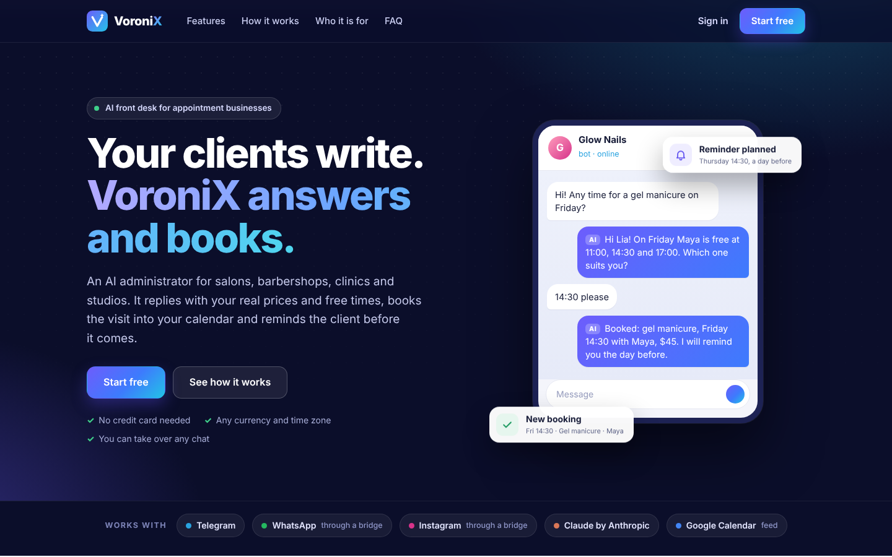
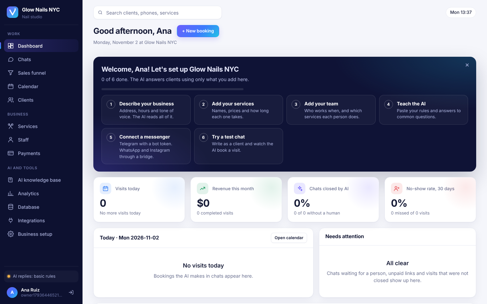

# VoroniX

**AI CRM for appointment businesses.** An AI administrator and CRM for salons, barbershops, clinics, studios and any business that works by appointment.
Clients write in **Telegram, WhatsApp or Instagram**. The AI answers **only from the CRM database**: real services, real prices, real free time. It books the visit, sends a prepayment link and moves the deal through the sales funnel. Complaints go to a human.
Many businesses share one server, and each one has its own separate data, time zone and currency.


| Requirement | How it is met | Proof |
|---|---|---|
| FR-01 messages from three messengers | `POST /api/channels/:business/:messenger/inbound`, Telegram bot adapter | `ai-flow.test.ts`, `tenancy.test.ts` |
| FR-02 answers from the database | 7 CRM tools; the AI never runs SQL itself | `ai-flow.test.ts` |
| FR-03 booking and payment | EXCLUDE constraint, payment transaction | `database.test.ts`, `api.test.ts` |
| NFR-01 reply within 5 s | every AI run logged in `ai_runs` with latency | p95 188 ms under load (rule engine) |
| Business-specific AI | “Teach the AI”: paste promotions, rules, a slogan; the AI sorts them into knowledge entries and settings in the database and uses them in replies | `teach.test.ts`, `ai-flow.test.ts` |
| Import any data | Excel, CSV, Word, JSON, text and tables pasted from Excel or Google Sheets are read in the browser into services, staff with working days and hours, clients, business settings and knowledge for the AI; PDF files and photos are read by Claude. The owner checks a preview, and everything is saved in one transaction | `import.test.js`, `import.test.ts` |
| BR-01 no invented prices | prices come from `services`, unknown services are refused | `ai-flow.test.ts` |
| Separate data per business | one PostgreSQL schema per business, queries without a business fail | `tenancy.test.ts` |

## Try it

| | Link | What works |
|---|---|---|
| Demo in the browser | [GitHub Pages](https://Yernazar-KBTU.github.io/VoroniX/) | The whole CRM with the demo barbershop Barberista; changes stay in your tab, the AI is off |
| Demo with the AI | [claude.ai](https://claude.ai/artifact/ADSNg68LNiherEJNbSeMdR) | Same CRM with a live AI administrator and a shared database |
| Full system | [Deploy to Render](https://render.com/deploy?repo=https://github.com/Yernazar-KBTU/VoroniX) | Landing page, sign-up, the CRM and PostgreSQL from `render.yaml`, free plan. Keys are added later on the service's Environment page |

Render's free plan is for trying the system: the site sleeps after 15 minutes without visitors and takes about a minute to wake up, and the free database expires 30 days after it is created ([render.com/docs/free](https://render.com/docs/free)). Real clients need paid plans ([render.com/pricing](https://render.com/pricing)).

## Import

The Import button on the Services, Staff, Clients and AI knowledge pages (and on the getting-started card) takes files or pasted text:

| Format | Read by |
|---|---|
| Excel `.xlsx` (every visible sheet), CSV and TSV in any delimiter and encoding (UTF-8, UTF-16, Windows-1251), tables copied from Excel, Google Sheets or Word, Markdown tables | the browser |
| Word `.docx` (paragraphs and tables), text, Markdown, JSON, HTML | the browser |
| PDF and photos (JPEG, PNG, WebP, HEIC from an iPhone) | Claude, when the business has it on |
| `.xls`, `.doc`, `.odt`, `.ods`, Numbers, Pages | not read: the window asks to save the file as `.xlsx`, `.docx` or PDF |

Columns are found by their headers in English, Russian or Kazakh (Name, Price, Duration, Days, Hours, Phone; Услуга, Цена, Длительность, Дни, Часы, Телефон), or by what the cells hold when there is no header. A schedule may have one column per weekday. Free text gives business settings (name, address, hours, phone, slogan, prepayment), price-list lines such as `Haircut, 45 min, $40` or `Стрижка ........ 5 000 ₸`, staff lines and knowledge entries. Staff services are matched by meaning, so `мужская стрижка` finds `Men's haircut`. Importing the same file again updates services and staff by name and skips clients whose phone is already known.

## Pages

| Address | What it is |
|---|---|
| `/` | Landing page for the link in an Instagram bio: what VoroniX does, how to start, FAQ |
| `/app` | The CRM: sign in, sign up, “Forgot password?”, then the workspace |
| `/terms`, `/privacy` | Terms of Service and Privacy Policy. Drafts: fill in the highlighted parts and have a lawyer check them before launch |



## Accounts and businesses

- **Sign up** creates a business and its owner. The business gets its own PostgreSQL schema `t_<id>` with every CRM table, so its clients, chats, bookings and numbering (`CL-0001`, `AP-1001`) are its own. The shared tables in `public` are `businesses`, `users`, `sessions` and `password_resets`.
- **Time zone and currency** are chosen at sign-up. “Today”, the calendar, reminders, the calendar feed and every price follow the business, not the server.
- **Sign in** with email and password (scrypt hash, HttpOnly cookie, 30 days with “Keep me signed in”, 10 failed attempts per 15 minutes).
- **Forgot password?** emails a link that works once and for one hour, through [Resend](https://resend.com). Without `RESEND_API_KEY` the email is only written to the server log.
- **Continue with Google** appears when `GOOGLE_CLIENT_ID` and `GOOGLE_CLIENT_SECRET` are set. Authorized redirect URI in Google Cloud: `<APP_URL>/api/auth/google/callback`.
- **Getting started**: a new business sees a six-step checklist on the dashboard: describe the business, add services, add the team, teach the AI, connect a messenger, try a test chat.
- **Webhooks carry the business id**: `POST /api/channels/<business id>/<messenger>/inbound` with the header `x-channel-secret`, and the calendar feed `GET /api/integrations/<business id>/calendar.ics?token=…`. The Integrations page shows both addresses.

## Integrations


The **Integrations** page connects a business to outside services. Tokens are checked against the real service, stored in the business's `integrations` table, never sent back in full and hidden from the read-only SQL console.

| Service | What it does | How |
|---|---|---|
| Telegram | The AI answers clients in your bot | Paste the @BotFather token; the bot starts at once |
| Claude AI | Claude writes the replies | Included when the server has `ANTHROPIC_API_KEY`; a business can paste its own Anthropic key instead |
| WhatsApp, Instagram | Messages land in Chats | Ready webhook address with its own `x-channel-secret` for Meta, 360dialog, Wazzup, Make or n8n |
| Google Calendar | Every visit in the team's calendars | Private iCal address, add it in Google or Apple Calendar |
| Webhook | New bookings and payments go to Make, Zapier, n8n, 1C, Google Sheets | Paste a URL; a test event is sent on connect |
| Kaspi Pay | Prepayment buttons lead to Kaspi QR | Offered to businesses in tenge. Merchant ID and key are stored; buttons stay in test mode until the contract is active |

## On one computer (CRM + VoroniX AI + data server)

Everything runs in the background on one Mac, with no browser tab and no Docker:

1. Install Node.js (LTS, nodejs.org) and PostgreSQL (Postgres.app). Only their programs are used; the script makes its own database on port 5433.
2. In Terminal: `curl -fsSL https://raw.githubusercontent.com/Yernazar-KBTU/VoroniX/main/scripts/mac/install.sh | bash`
3. Open http://localhost:3000, create an account, then Integrations, Telegram: paste the bot token.
4. Click the AI chip at the top of the CRM to watch VoroniX AI work live (http://localhost:4000/live).

The script ([scripts/mac/install.sh](scripts/mac/install.sh)) downloads and builds the CRM, VoroniX AI and the data server from GitHub, and macOS (launchd) starts them at every login. Run the same command again to update; add `-s -- --remove` after `bash` to stop and remove them (the data stays in `~/.voronix/pgdata`). Logs: `~/Library/Logs/VoroniX`. `docker-compose.yml` does the same with Docker.

Clients' messages go from Telegram to the CRM and on to VoroniX AI. Its memory (clients, bookings, lessons, model versions) is kept by the [VoroniX data server](https://github.com/kamilabalabatyr/voronix-data-server) in the CRM's own database, and its bookings appear in the CRM calendar.

## Quick start

```bash
docker compose up --build        # PostgreSQL 16 + app on http://localhost:3000
docker compose exec app node apps/api/dist/db/seed.js   # optional: the demo barbershop
```

Without Docker (Node 20+, PostgreSQL 16):

```bash
cp .env.example .env             # set DATABASE_URL
npm install
npm run db:migrate && npm run db:seed
npm run dev                      # API :3000, web :5173 (open http://localhost:5173/app)
```

Sign in as `demo@voronix.dev` / `demo-password`, or press **Create an account** to start your own business.

A copy of the site that runs without a server (for static hosting or a quick look): `npm run build:demo -w apps/web` writes it to `apps/web/dist-demo`. It answers the CRM's requests from `apps/web/src/demo/demo-data.json`; refresh that file from a running server with `node apps/web/scripts/capture-demo-data.mjs`. In this copy any email and password sign in, changes stay in the browser tab, and Claude is off.

A database from before accounts (tables directly in `public`) is not migrated in place: `npm run db:migrate` stops and asks for `npm run db:reset`, which deletes all data and builds the new layout. `db:reset` refuses to run with `NODE_ENV=production`.

### Settings

| Variable | What it is for |
|---|---|
| `DATABASE_URL` | PostgreSQL connection (the only required one) |
| `APP_URL` | Public address of the app, used in email links and the Google redirect. On Render it defaults to the service's onrender.com address (`RENDER_EXTERNAL_URL`) |
| `ANTHROPIC_API_KEY` | Claude writes the replies for every business that has not connected its own key. Without it the built-in rule engine answers, with the same tools and data |
| `VORONIX_AI_URL`, `VORONIX_AI_KEY` | Address (and optional key) of [VoroniX AI](apps/voronix-ai/README.md), our own intent model. The built-in agent asks it what each client message means; without it, or when it does not answer within `VORONIX_AI_TIMEOUT_MS` (2500 ms), the rules decide alone |
| `VORONIX_DATA_URL` | Address of the VoroniX data server. With it and `VORONIX_AI_URL` set, VoroniX AI answers every chat itself, with its memory in this database (see "On one computer"). When it does not answer, the chat goes to a person and the CRM shows "VoroniX AI is down" |
| `VORONIX_AI_PUBLIC_URL`, `VORONIX_DATA_PUBLIC_URL` | Addresses the browser uses to open the live AI page from the AI chip |
| `RESEND_API_KEY`, `MAIL_FROM` | Password reset emails. `MAIL_FROM` must use a domain verified in Resend |
| `SUPPORT_EMAIL` | “Help” on the sign-in page and “Contact” on the public pages; hidden when empty |
| `GOOGLE_CLIENT_ID`, `GOOGLE_CLIENT_SECRET` | “Continue with Google” |
| `SQL_CONSOLE` | `on` shows the Database page with the read-only SQL console. Default: on outside production, off in production |
| `ALLOW_DEMO_RESET` | Lets a business load the demo barbershop. Default: on outside production, off in production |
| `CHANNEL_WEBHOOK_SECRET` | Optional secret that every business's inbound webhook accepts, for a gateway the platform runs itself |

Empty values (`SUPPORT_EMAIL=`) count as not set.

## VoroniX AI (our own model)

[`apps/voronix-ai`](apps/voronix-ai/README.md) is a separate web service with its own API and home page. It was trained by the team on 638 client phrases in Russian, Kazakh and English and tells the CRM what a client wants (book, price, cancel, complaint, address, hours, agree, thanks, greeting). The built-in AI administrator uses it and now answers in Kazakh too. Run it with `npm run dev:ai` (port 4000) and set `VORONIX_AI_URL=http://localhost:4000`; retrain and re-measure with `npm run train`.

## Architecture

```
Telegram / WhatsApp / Instagram ──► channel webhook (business id) ─┐
Landing page, Terms, Privacy (static)                              │
Web CRM (Vite, ES modules) ──────► REST API, session cookie ───────┤  Express 5 + TypeScript
                                   ◄── SSE events (own business) ──┤
                                                                   ├─► services (booking, conversations)
                                   AI runner ──────────────────────┤      └─► repositories ─► PostgreSQL 16
                                   (Claude | offline)              ┘          schema per business
```

```
apps/
  api/                 Express API, AI engines, Telegram adapter
    src/
      ai/              runner, Claude tool loop, offline NLU engine, tools, context
      auth/            accounts, sessions, password reset, Google sign-in
      channels/        telegram.ts
      db/              pool (schema per request), migrations runner, demo seed, reset
      domain/          pure logic: free slots, prepayment rule, types
      integrations/    Integrations page: catalogue, connect, test, per-business bots
      repositories/    SQL per table
      routes/          HTTP + zod validation
      services/        booking, conversation and reminder workflows (transactions)
      tenancy/         which business a request belongs to
    test/unit          60 tests, no database
    test/integration   111 tests on a real PostgreSQL
  web/
    index.html         landing page
    app.html           the CRM (13 pages), live updates over SSE
    terms.html, privacy.html
db/migrations/core     001_accounts.sql: businesses, users, sessions, password resets (schema public)
db/migrations/tenant   001_init.sql … 006_reminders.sql: the CRM tables, applied to every business schema
site/                  browser-only demo published to GitHub Pages
render.yaml            one-click deploy of the full system to Render
tests/load/            autocannon load test
docs/                  architecture, database, test report, screenshots
```

More: [architecture](docs/architecture.md) · [database](docs/database.md) · [testing](docs/testing.md)

## Database


Rules the database enforces itself, so neither the AI nor a person can break them:

- **No double booking**: `EXCLUDE USING gist (master_id WITH =, tsrange(start_at, end_at) WITH &&)`.
- **Only qualified masters**: composite FK `(master_id, service_code) → master_services`.
- **Valid values**: CHECK on codes, prices, durations, statuses and funnel stages. A paid payment must have `paid_at`.
- **One business per query**: every connection runs with `search_path` set to that business's schema; without a business only `public` is visible and CRM queries fail.
- **Reports are read-only**: the SQL console runs as `crm_readonly` in a `READ ONLY` transaction with a 3 s timeout, one statement at a time.

## Tests

```bash
npm test                 # 203 tests: 181 for the API (unit + integration, needs PostgreSQL, uses crm_test), 22 for the web import
npm run db:seed && npm start & npm run test:load
```

| Suite | Tests | Result |
|---|---|---|
| Unit: scheduling, pricing, message understanding, Teach the AI, log redaction, settings | 60 | passed |
| Integration: database rules | 20 | passed |
| Integration: REST API | 25 | passed |
| Integration: accounts, password reset, Google sign-in | 19 | passed |
| Integration: separate businesses, time zones, currencies | 13 | passed |
| Integration: AI chat funnel and Teach the AI | 12 | passed |
| Integration: Integrations page, webhooks, calendar feed | 11 | passed |
| Integration: visit reminders | 5 | passed |
| Integration: web pages | 6 | passed |
| Integration: data import | 10 | passed |
| Web: import readers and parsers | 22 | passed |

Load test (single Node process, laptop-class container, 50 connections, 0 errors; it signs in as the demo owner first):

| Endpoint | req/s | p50 | p99 |
|---|---|---|---|
| `GET /api/services` | 1 337 | 35 ms | 63 ms |
| `GET /api/appointments/free-slots` | 916 | 52 ms | 82 ms |
| `GET /api/analytics/no-shows` | 1 167 | 41 ms | 69 ms |
| `POST /api/channels/:business/whatsapp/inbound` | 265 | 72 ms | 119 ms |

## Screens

| | |
|---|---|
|  |  |
|  |  |

## Team

Basics of Information Systems, Fall 2026. Balabatyr Kamila, Ussenbayeva Alua, Aitakhyn Inzhu, Askarova Akbota, Altynbekov Yernazar, Nurzhanov Amirkhan.

MIT License.
