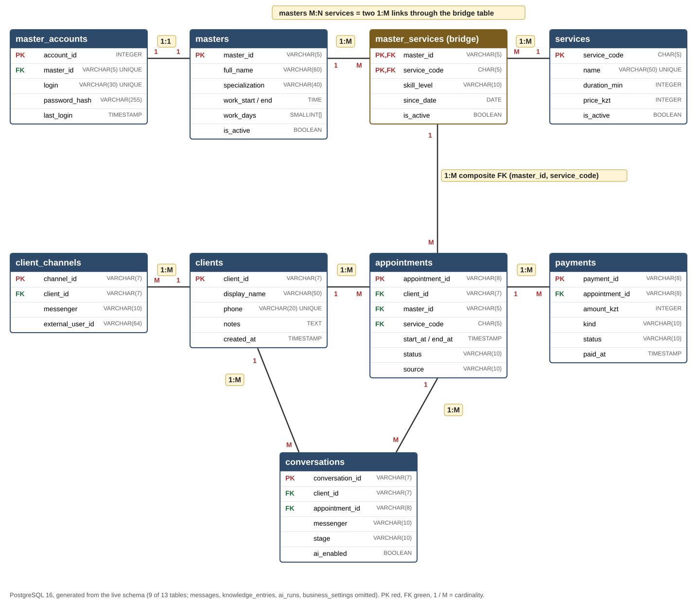

# Database

PostgreSQL 16. Schema: [`db/migrations/001_init.sql`](../db/migrations/001_init.sql), reporting: [`002_reporting.sql`](../db/migrations/002_reporting.sql). Migrations run in order, each in its own transaction, and are recorded in `schema_migrations`.



| Table | Rows (demo) | Purpose |
|---|---|---|
| clients | 30 | one card per real person |
| client_channels | 35 | messenger accounts of a client, `UNIQUE (messenger, external_user_id)` |
| services | 7 | catalogue and prices the AI may offer |
| masters | 4 | staff, working hours and days |
| master_services | 9 | bridge table, M:N masters ↔ services |
| master_accounts | 4 | 1:1 login, only a password hash |
| appointments | 242 | visits; EXCLUDE constraint prevents overlaps |
| payments | 188 | prepayments and full payments |
| conversations | 4 | one chat = one deal in the funnel |
| messages | 16 | chat history |
| knowledge_entries | 6 | what the AI knows beyond the tables |
| ai_runs | – | every AI reply with latency (NFR-01) |
| business_settings | 1 | name, hours, prepayment rule |

## Task 9 query

```sql
SELECT service, finished_visits, no_shows, no_show_pct, lost_revenue_kzt
FROM v_no_show_by_service
WHERE month = date_trunc('month', now())::date
ORDER BY no_show_pct DESC;
```

October 2026: hair colouring has 46.7% no-shows and lost 175 000 ₸. Decision: 30% prepayment for services from 20 000 ₸; the AI sends the payment link when booking.

## Payment transaction

`booking.service.markPaid` locks the payment, sets it `Paid`, confirms the visit, moves the chat to `Paid` and writes a chat note in one transaction. A repeated webhook changes nothing.
