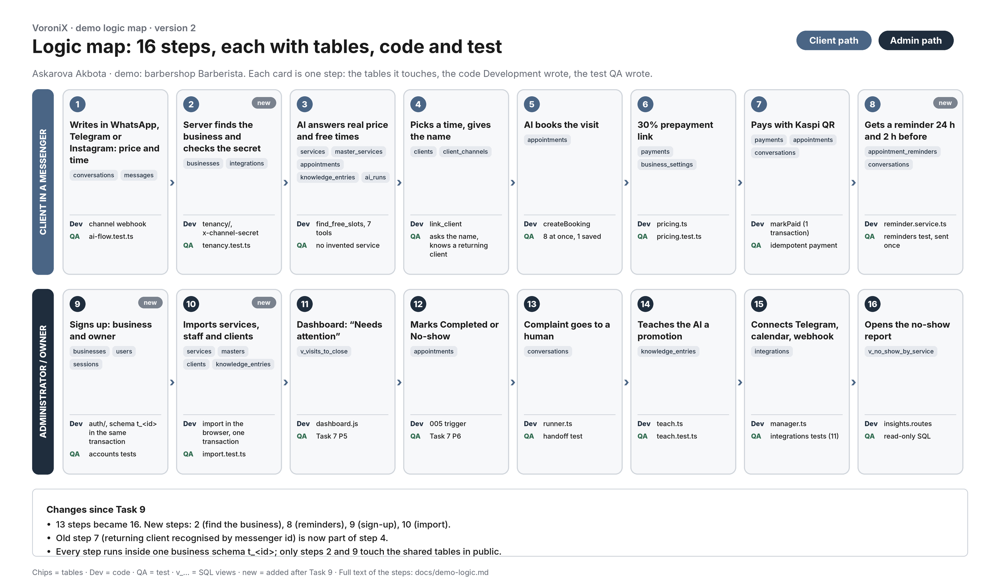

# Demo logic map

16 steps of the VoroniX demo (barbershop Barberista). Each step lists the tables it touches, the code Development wrote for it and the test QA wrote for it. Every step runs inside one business schema `t_<id>`; only steps 2 and 9 touch the shared tables in `public`.

## Client path

| # | Step | Tables | Code | Test |
|---|------|--------|------|------|
| 1 | Writes in WhatsApp, Telegram or Instagram: price and time | `conversations`, `messages` | channel webhook | `ai-flow.test.ts` |
| 2 | Server finds the business and checks the secret (new) | `businesses`, `integrations` | `tenancy/`, `x-channel-secret` | `tenancy.test.ts` |
| 3 | AI answers real price and free times | `services`, `master_services`, `appointments`, `knowledge_entries`, `ai_runs` | `find_free_slots`, 7 tools | no invented service |
| 4 | Picks a time, gives the name; a returning client is recognised by messenger id | `clients`, `client_channels` | `link_client` | asks the name |
| 5 | AI books the visit | `appointments` | `createBooking` | 8 at once, 1 saved |
| 6 | 30% prepayment link | `payments`, `business_settings` | `pricing.ts` | `pricing.test.ts` |
| 7 | Pays with Kaspi QR | `payments`, `appointments`, `conversations` | `markPaid` (1 transaction) | idempotent payment |
| 8 | Reminder 24 h and 2 h before (new) | `appointment_reminders`, `conversations` | `reminder.service.ts` | reminders test |

## Admin path

| # | Step | Tables | Code | Test |
|---|------|--------|------|------|
| 9 | Signs up: business and owner (new) | `businesses`, `users`, `sessions` | `auth/`, schema `t_<id>` in the same transaction | accounts tests |
| 10 | Imports services, staff and clients (new) | `services`, `masters`, `clients`, `knowledge_entries` | import in the browser, one transaction | `import.test.ts` |
| 11 | Dashboard: "Needs attention" | `v_visits_to_close` | `dashboard.js` | Task 7 P5 |
| 12 | Marks Completed or No-show | `appointments` | `005` trigger | Task 7 P6 |
| 13 | Complaint goes to a human | `conversations` | `runner.ts` | handoff test |
| 14 | Teaches the AI a promotion | `knowledge_entries` | `teach.ts` | `teach.test.ts` |
| 15 | Connects Telegram, calendar, webhook | `integrations` | `manager.ts` | integrations tests |
| 16 | Opens the no-show report | `v_no_show_by_service` | `insights.routes` | read-only SQL |

## What changed since Task 9

- 13 steps became 16: new steps 2, 8, 9 and 10.
- The old step 7 (returning client recognised by messenger id) now lives inside step 4.
