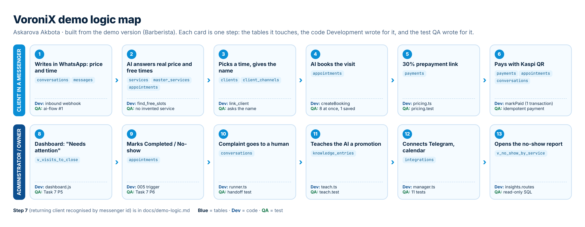

# Demo logic

Made from the demo version of VoroniX (barbershop Barberista) by Askarova Akbota. Each row is one step of the demo. Development used the "Code" column to build the step, QA used the "Checked by" column as the test plan.

## Client side: from the first message to the payment

| # | What happens | Screen | Tables | Rule | Code | Checked by |
|---|---|---|---|---|---|---|
| 1 | Client writes "Сколько стоит VIP-ритуал? Можно в пятницу?" in WhatsApp | Chats | conversations, messages | one chat per messenger user | `routes/conversations.routes.ts` (inbound webhook) | ai-flow: answers price and free times |
| 2 | AI answers the price and free times from the database | Chats | services, masters, master_services, appointments | BR-01: only real prices | `ai/tools.ts` find_free_slots | ai-flow: does not invent a service |
| 3 | Client picks 18:00 and gives the name | Chats | clients, client_channels | `UNIQUE (messenger, external_user_id)` | `ai/tools.ts` link_client | ai-flow: asks the name |
| 4 | AI books the visit | Calendar | appointments | EXCLUDE: no overlap for one barber | `services/booking.service.ts` createBooking | database: 8 bookings at once, 1 saved |
| 5 | AI sends the 30% prepayment link | Chats | payments | prepayment from 20 000 ₸ | `domain/pricing.ts` | pricing.test.ts |
| 6 | Client pays with Kaspi QR | Chats, Payments | payments, appointments, conversations, messages | one transaction for 4 tables | `booking.service.ts` markPaid | api: Paid, Confirmed and chat Paid together |
| 7 | Client writes again next month | Chats | client_channels | recognised by messenger id | `services/conversation.service.ts` | ai-flow: recognises the same person |

## Administrator side

| # | What happens | Screen | Tables | Rule | Code | Checked by |
|---|---|---|---|---|---|---|
| 8 | Admin sees today's visits and "Needs attention" | Dashboard | appointments, payments, conversations | past "Booked" visits are listed (Task 7, P5) | `pages/dashboard.js`, view `v_visits_to_close` | database: P5 |
| 9 | Admin marks a visit Completed or No-show | Dashboard, Calendar | appointments | not before the visit starts (Task 7, P6) | `005_data_quality.sql` trigger | database: P6, api: visit_not_started |
| 10 | Complaint in a chat goes to a human | Chats | conversations | AI stops answering | `ai/runner.ts` | ai-flow: hands a complaint to a human |
| 11 | Owner teaches the AI a promotion | Knowledge | knowledge_entries, business_settings | text is saved as data, not code | `ai/teach.ts` | teach.test.ts |
| 12 | Owner connects Telegram and the calendar | Integrations | integrations | tokens never returned or visible in SQL | `integrations/manager.ts` | integrations.test.ts |
| 13 | Owner opens the no-show report | Analytics, Database | v_no_show_by_service | read-only SQL role | `routes/insights.routes.ts` | api: SQL console refuses DELETE |

